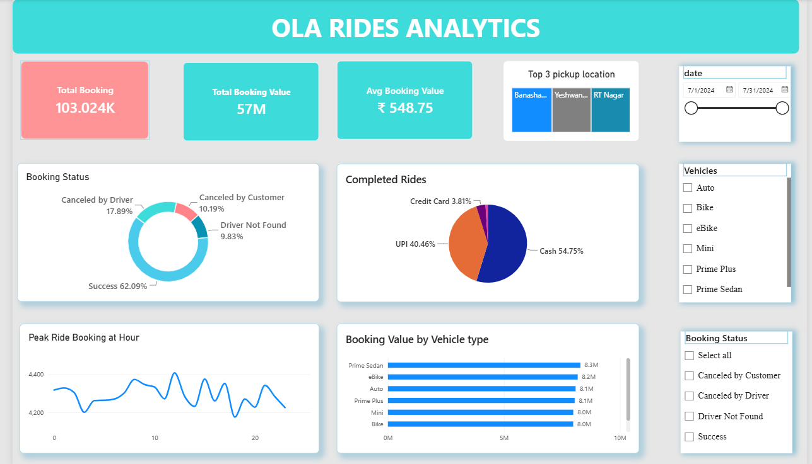

#  Ola Rides Analytics Dashboard

**A SQL + Power BI project analyzing 103,024 ride bookings to find why 38% of bookings fail and what to fix first.**

## 📌 Problem Statement
Ola earns nothing when a booking does not turn into a completed ride. This project analyzes 103,024 July 2024 bookings to answer one question: **why do bookings fail, and which cause should be fixed first to recover the most booking value?** Vehicle, payment and demand patterns are analyzed as supporting context.

## 🗂️ Dataset
- 103,024 bookings · July 2024
- Fields: Date,Time,Booking_ID,	Booking_Status,	Customer_ID, Vehicle_Type, Pickup_Location,	Drop_Location, V_TAT, C_TAT,	Canceled_Rides_by_Customer,	Canceled_Rides_by_Driver, Incomplete_Rides,	Incomplete_Rides_Reason	Booking_Value,	Payment_Method,	Ride_Distance,	Driver_Ratings,	Customer_Ratings

## 🛠️ Tools
MySQL Workbench (data cleaning & querying) · Power BI (dashboard)

## What I Did
1. Imported raw CSV data into MySQL and resolved real-world import issues — encoding errors, column mismatches, inconsistent line endings
2. Validated data quality: checked for duplicates, invalid values, and confirmed missing fields (ratings, payment) were expected for cancelled rides
3. Wrote SQL queries to analyze booking status, booking value lost to failed bookings, cancellation reasons, failure rate by vehicle and hour, payment mix, and top locations
4. Built an interactive Power BI dashboard with KPI cards, charts, and slicers for filtering by date, vehicle, and status

## 📊 Key Findings
- **Total booking value was ₹56.5M**, but only **₹35.1M came from completed rides**. **₹21.5M (38%) was lost** to failed bookings.
- **Only 63.97K rides (62.09%) were completed.** Driver cancellations were 18.43K (17.89%), customer cancellations 10.5K (10.19%), and 10.1K bookings (9.83%) never found a driver.
- **Drivers cancel about 1.75x as often as customers.** The top driver reason is personal and car related issues (6,542).
- **About 56% of customer cancellations are driver-triggered**, such as "Driver is not moving towards pickup" and "Driver asked to cancel".
- **Failure rates are the same across vehicle types (37% to 39%)**, so the problem is system-wide, not one vehicle category.
- **Cash is the most used payment method** for completed rides (54.75%), followed by UPI (40.46%).
- **Prime Sedan was the top-earning vehicle** by completed revenue (₹5.2M), though the gap to the others is small.
- **Demand is fairly flat.** The busiest hour (12:00) and day (Tuesday) are only slightly above the rest.

## Recommendation
Most lost bookings come from the driver side. I'd fix three things first:

1. **Cut driver cancellations.** Drivers cancel almost twice as often as customers (18.4K vs 10.5K).
2. **Match every booking to a driver.** About 10.1K bookings never found one.
3. **Make pickups reliable.** About 56% of customer cancellations happen because the driver isn't coming.
1. **Cut driver cancellations.** Drivers cancel almost twice as often as customers (18.4K vs 10.5K).
2. **Match every booking to a driver.** About 10.1K bookings never found one.
3. **Make pickups reliable.** About 56% of customer cancellations happen because the driver isn't coming.

## ⚠️ Limitations
One month of data, and failure rates are nearly identical across vehicles, hours and locations. There is no driver supply or wait-time data, so the cause of "Driver Not Found" can't be confirmed.

## Dashboard

## 📁 Files in This Repo
- `Ola_Rides_Dashboard.pbix` — Power BI dashboard
- `OLAqueries.sql` — all SQL queries used
- `screenshot/` — dashboard preview images

---
**Ananya Singh** 
· [linkedin.com/in/ananya-singh04](https://linkedin.com/in/ananya-singh04) 
